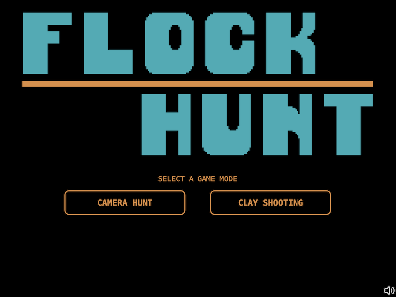
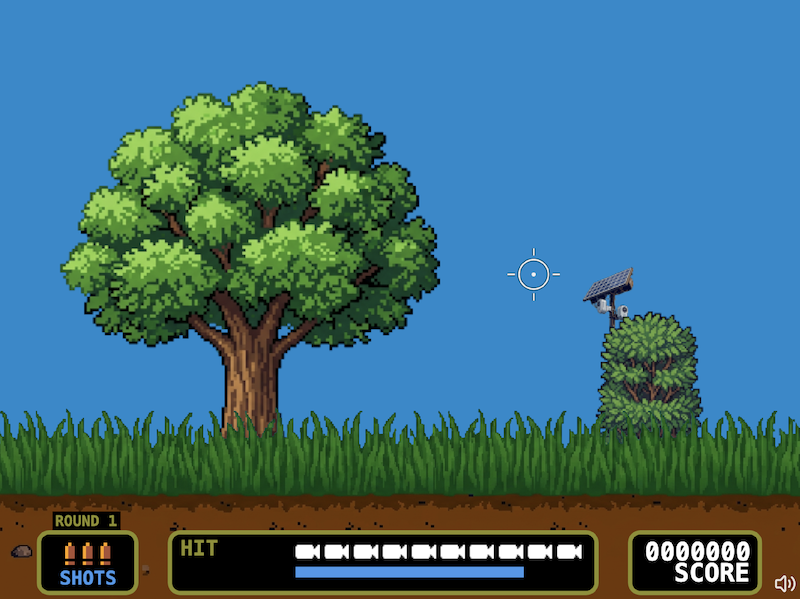

# Flock Hunt

A browser-based pixel art shooter built with TypeScript and the HTML Canvas API — no game engine, no framework.





**[Play it live →](https://josedcruz.github.io/flock-hunt/)**

---

## What it is

Shoot surveillance cameras before they cross the screen. Rack up points across 5 rounds, survive the boss fight, then try Clay Shooting mode for a change of pace.

Two game modes:
- **Camera Hunt** — cameras fly across the field; hit them before they escape
- **Clay Shooting** — skeet-style targets arc across a different backdrop

---

## How it's built

No game engine. Everything is hand-rolled on `<canvas>`:

| Layer | What it does |
|---|---|
| `Game` | Central state machine — owns round/score/boss logic |
| `Renderer` | Orchestrates back-to-front draw order (sky → entities → grass → HUD) |
| `InputHandler` | Unified mouse + touch input, converts screen → logical coordinates |
| `AudioManager` | Howler.js wrapper; Web Audio for SFX, HTML5 streaming for music |
| `FlockCamera` | Per-entity state machine: spawning → flying → hit → explosion → sinking |
| `BossRobot` | Idle / run / somersault AI with hit-flash, damage phases, and death animation |
| `Character` | Dog companion — walk-in, jump arc, laugh/sulk reactions |
| `Hud` | Sprite-based HUD: ammo, score, round tracker, anonymity meter |

**Stack:** TypeScript · Vite · Howler.js · HTML Canvas API · GitHub Actions / Pages

---

## Run locally

```bash
npm install
npm run dev
```

Build for production:

```bash
npm run build
```

---

## Controls

| Input | Action |
|---|---|
| Click / tap | Shoot |
| Mouse move | Aim reticle |
| Sound button (lower-right) | Toggle audio |

Sound defaults to **on** on desktop and **off** on touch devices.
